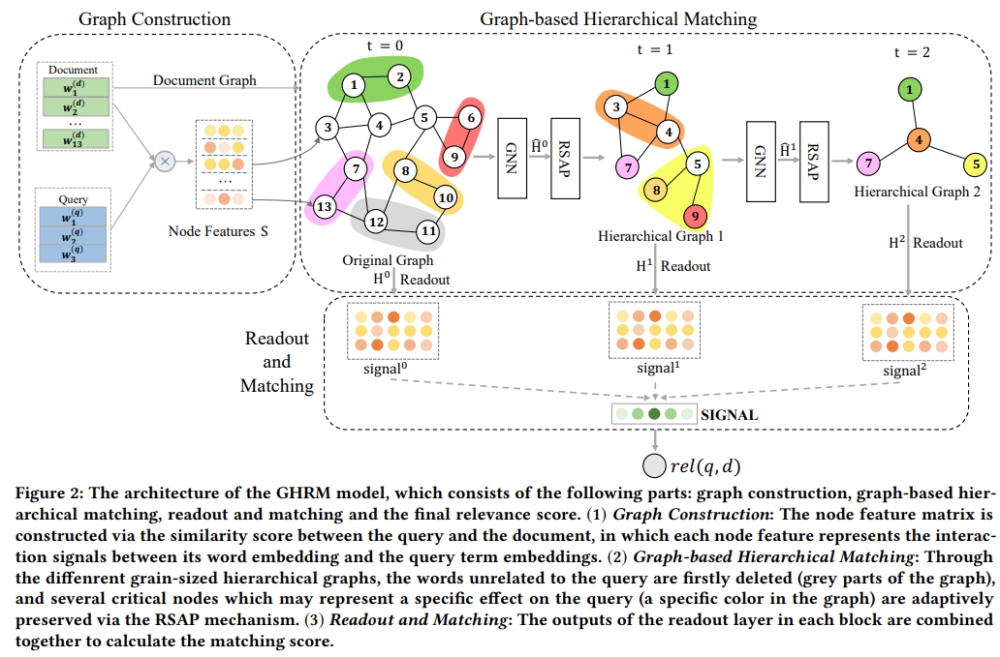

# GHRM



This is the code for the WWW 2021 Paper: [Graph-based Hierarchical Relevance Matching Signals for Ad-hoc Retrieval](https://dl.acm.org/doi/abs/10.1145/3442381.3450115).

## Usage

### Data 

Here are two datasets we used in our paper. After downloaded the whole datasets, you can put the `queries.tsv` and `documents.tsv` into the corresponding `robust04` or `clueweb09` subfolder in `Data`:
* Robust04: https://trec.nist.gov/data/cd45/index.html
* ClueWeb09-B: https://lemurproject.org/clueweb09/

### Quick Start
You first need to process the data, for example: `cd Data`; and orderly running `python preprocess.py` , `python bulid_dict.py`, `python gen_word_embeddings.py`, `python graph_construction.py` and `idf_construction.py`. <br/>

Then you can run the file `Code/run.py` to train the model. <br/>

For example: `cd Code; python run.py --model GHRM --gpuid 0 --qrl_len 4 --dataset robust04` <br/>

## Requirements

- Python 3.6+
- PyTorch 1.5.1

## Citation

Please cite our paper if you use the code:

```
@inproceedings{yu2021graph,
title={Graph-based Hierarchical Relevance Matching Signals for Ad-hoc Retrieval},
author={Yu, Xueli and Xu, Weizhi and Cui, Zeyu and Wu, Shu and Wang, Liang},
booktitle={Proceedings of the Web Conference 2021},
pages={778--787},
year={2021}
}
```
